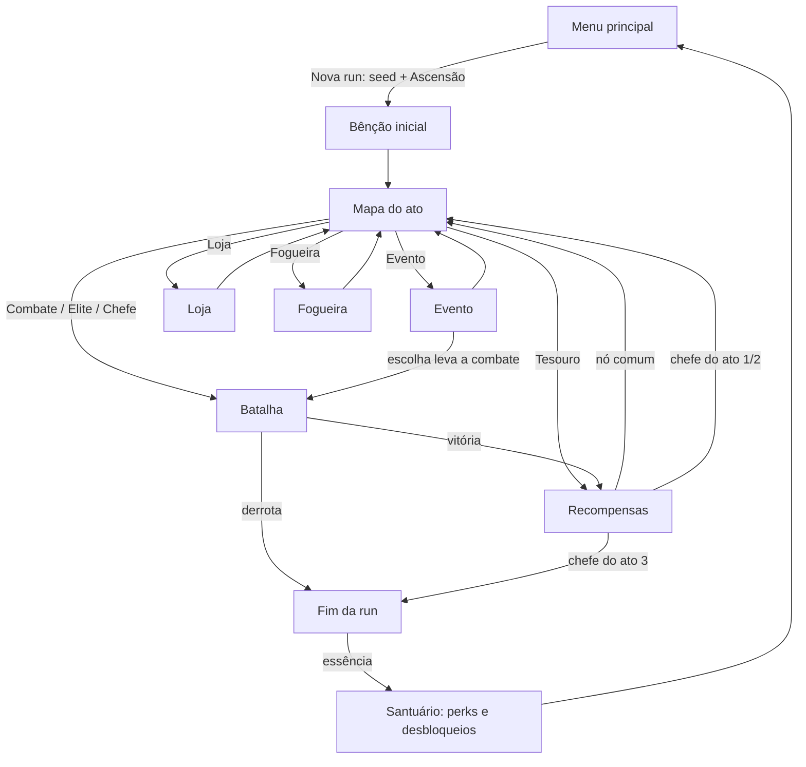
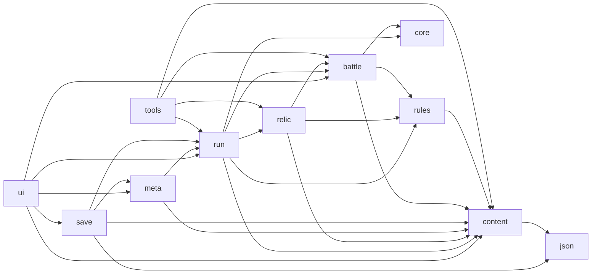
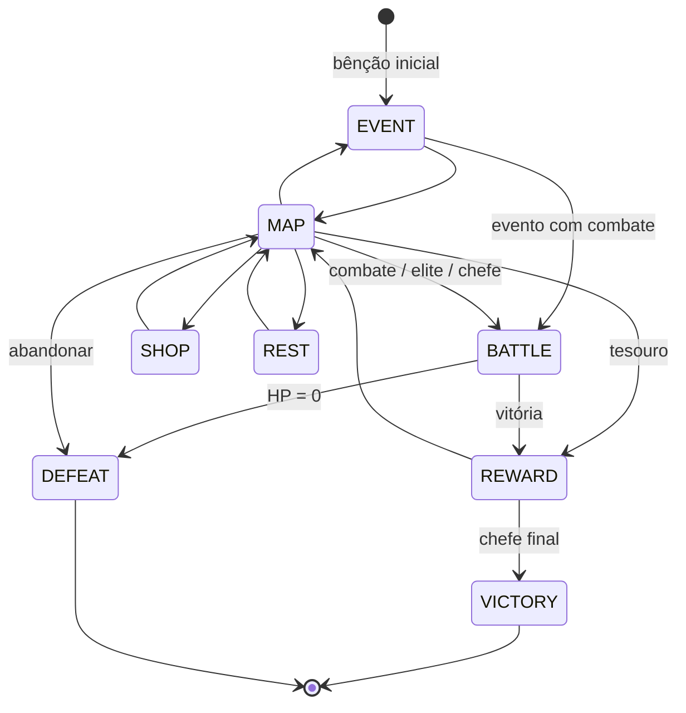

# Documentação Técnica — Tower Rogue

Este documento explica **o que** o jogo faz, **como** cada sistema foi implementado e, principalmente, **por que** cada decisão foi tomada. Ele acompanha o código: os nomes de classes citados existem em `src/main/java/io/github/lucasstml/towerrogue/`.

## Sumário

1. [Visão geral](#1-visão-geral)
2. [O ciclo de jogo](#2-o-ciclo-de-jogo)
3. [Arquitetura](#3-arquitetura)
4. [Núcleo: RNG, seeds, eventos e JSON](#4-núcleo-rng-seeds-eventos-e-json)
5. [Conteúdo data-driven](#5-conteúdo-data-driven)
6. [Simulação de batalha](#6-simulação-de-batalha)
7. [Camada roguelike (a run)](#7-camada-roguelike-a-run)
8. [Meta-progressão](#8-meta-progressão)
9. [Persistência](#9-persistência)
10. [Interface e renderização](#10-interface-e-renderização)
11. [Balanceamento com bot](#11-balanceamento-com-bot)
12. [Padrões de projeto](#12-padrões-de-projeto)
13. [Decisões e trade-offs](#13-decisões-e-trade-offs)
14. [Da versão 1 para a versão 2](#14-da-versão-1-para-a-versão-2)
15. [Limitações e próximos passos](#15-limitações-e-próximos-passos)

---

## 1. Visão geral

| | |
|---|---|
| Linguagem | Java 21 (compila com `--release 21`; testado no JDK 26) |
| Dependências | nenhuma — só a biblioteca padrão (Swing/AWT/Java2D) |
| Tamanho | ~10,4 mil linhas de Java em 98 arquivos + ~730 linhas de conteúdo JSON |
| Build | `build.ps1` / `build.sh` (javac + jar) |
| Execução | `java -jar build/TowerRogue.jar` ou `java -cp build/classes ...Main` |

Objetivos do projeto, em ordem de prioridade:

1. **Profundidade de jogo**: um roguelike de verdade, com decisões que se acumulam ao longo da run (que torres pegar, que caminho seguir no mapa, quando arriscar).
2. **Arquitetura de jogo sólida**: simulação separada da apresentação, determinística e dirigida por dados.
3. **Zero dependências**: qualquer pessoa com um JDK consegue compilar e jogar, sem baixar nada.

## 2. O ciclo de jogo



- **Dentro da batalha** a economia é a **mana**, que reinicia a cada batalha: você constrói, melhora (níveis 1→2→3) e especializa torres (uma de duas ramificações no nível 3).
- **Entre batalhas** a economia é o **ouro** (loja) e o poder vem de **blueprints** (quais torres você pode construir e em que tier), **relíquias** e **HP da run**.
- **Entre runs** a economia é a **essência**, que compra perks e desbloqueia conteúdo.

Essa separação em três camadas de economia é o que dá ao jogo o "sabor" roguelike: a batalha é um quebra-cabeça tático, a run é uma construção estratégica de deck, e a meta-progressão dá sensação de evolução mesmo quando você perde.

## 3. Arquitetura

### 3.1 Pacotes e dependências



| Pacote | Responsabilidade |
|---|---|
| `core` | `Rng` (SplitMix64), `SeedCodec`, `EventBus`, `MathUtil` |
| `json` | parser e writer JSON escritos à mão |
| `content` | definições imutáveis (`TowerDef`, `EnemyDef`, ...) e `ContentLoader` com validação |
| `rules` | `Modifiers`: todas as alterações de regras (relíquias, perks, Ascensão) num objeto só |
| `battle` | a simulação de tower defense; `battle.ability` tem as habilidades de inimigos |
| `relic` | transforma efeitos de relíquia do JSON em código |
| `run` | estado da run, mapa ramificado, recompensas, loja, eventos (`RunController`) |
| `meta` | perfil persistente, essência, perks, desbloqueios |
| `save` | serialização e escrita atômica |
| `tools` | bot `AutoPlayer` e ferramentas headless (`Headless`) |
| `ui` | janela, loop, input, UI immediate mode, arte, partículas, telas |

**Regras que a arquitetura garante:**

- `battle` **não importa nada de `ui`, `run`, `meta` ou `save`**. A simulação recebe tudo o que precisa num `BattleConfig` e devolve um `BattleResult`. Por isso ela roda sem janela (bot, verificação de determinismo, relatório de balanceamento).
- `run` não conhece Swing nem arquivos. O `RunController` só expõe métodos (`chooseNode`, `takeReward`, `buyItem`...) e um callback `onChange`, que a aplicação usa para salvar.
- Nenhum singleton global: `Content`, `SaveManager` e `Profile` são passados explicitamente (via `App` na UI). Isso torna cada sistema testável isoladamente.

### 3.2 Fluxo de dados de uma batalha

```mermaid
sequenceDiagram
    participant EDT as Thread AWT (EDT)
    participant In as Input (fila)
    participant Loop as Thread game-loop
    participant Scr as BattleScreen
    participant Sim as Battle
    participant Fx as Particles
    EDT->>In: mousePressed / keyPressed (só enfileira)
    Loop->>In: poll() uma vez por frame
    Loop->>Scr: update(1/60) × N  (passos fixos)
    Scr->>Sim: step() × velocidade
    Sim-->>Scr: Fx (eventos cosméticos)
    Scr->>Fx: cria partículas
    Loop->>Scr: render(g, ui)
    Scr->>Sim: submit(BattleCommand) + processCommands()
```

O jogador nunca altera a simulação diretamente: a interface envia **comandos**. A simulação nunca desenha nada: ela emite **`Fx`** (por exemplo, "algo explodiu aqui"), que só a interface lê.

## 4. Núcleo: RNG, seeds, eventos e JSON

### 4.1 `Rng`: por que não `java.util.Random`

`java.util.Random` também é determinístico, mas o seu estado interno de 48 bits **não pode ser lido nem restaurado**. Num roguelike com save no meio da run isso é fatal: ao carregar, os números aleatórios não continuariam de onde pararam.

`Rng` implementa **SplitMix64**: o estado inteiro é um único `long` (`getState`/`setState`), a qualidade estatística é excelente e o código cabe em poucas linhas. `nextInt(bound)` usa *rejection sampling* para não ter viés de módulo.

### 4.2 Streams independentes

Um erro clássico em roguelikes é usar um único gerador para tudo: comprar um item na loja "consome" números aleatórios e muda quais eventos aparecem depois. Aqui cada sistema tem **o seu próprio stream**, derivado da seed da run por nome:

```java
Rng.derive(seed, "rewards");   // drafts e relíquias de recompensa
Rng.derive(seed, "shop");      // estoque e preços
Rng.derive(seed, "events");    // eventos e apostas
Rng.derive(seed, "map:" + act);  // mapa de cada ato
Rng.deriveSeed(seed, "battle:" + act + ":" + node + ":" + counter);  // seed de cada batalha
```

`deriveSeed` combina a seed com um hash FNV-1a do rótulo e passa pelo misturador do SplitMix64. Dentro da batalha a separação continua: `map`, `waves` e `combat` são streams diferentes. Assim o layout do mapa nunca depende de quantos críticos aconteceram.

### 4.3 Seeds compartilháveis

`SeedCodec` converte seeds de 50 bits em códigos **Crockford base-32** de 10 caracteres (sem `I`, `L`, `O`, `U`, que se confundem com números). Qualquer texto digitado pelo jogador também vira uma seed válida via hash ("lucas" sempre gera a mesma run).

### 4.4 `EventBus`

Um publish/subscribe síncrono indexado pela classe do evento. A batalha publica fatos (`EnemyKilled`, `WaveCleared`, `EnemyLeaked`, `Hit`) e as relíquias reativas se inscrevem. Os handlers são chamados **na ordem de inscrição** (que é a ordem das relíquias), então o barramento não introduz não-determinismo. A iteração é por índice, para que um handler possa inscrever outro sem `ConcurrentModificationException`.

### 4.5 Parser JSON próprio

Para manter zero dependências, `JsonParser` é um parser *recursive descent* (RFC 8259) com uma extensão: aceita comentários `//`, o que permite documentar os arquivos de conteúdo. Dois detalhes importantes:

- Números sem ponto/expoente viram `Long`, não `Double`. Seeds de 64 bits e estados de RNG perderiam precisão num `double`.
- Mensagens de erro trazem **linha e coluna**, e os getters tipados de `JsonObject` informam a chave que faltou e o `id` do objeto. Um erro num JSON de conteúdo aparece assim: `towers.json entry #3: missing required key 'cost' in object with id 'cannon'`.

## 5. Conteúdo data-driven

### 5.1 Arquivos

Tudo o que é "conteúdo" está em `src/main/resources/data/`:

| Arquivo | Define |
|---|---|
| `towers.json` | 11 torres: stats, níveis, especializações, efeitos ao acertar, tags |
| `enemies.json` | 19 inimigos (inclusive 3 chefes) e suas habilidades |
| `affixes.json` | 7 afixos de elite |
| `acts.json` | 3 atos: pool de inimigos com custo de ameaça, curva de orçamento, tema visual |
| `relics.json` | 32 relíquias, compostas por efeitos |
| `events.json` | 11 eventos com escolhas e resultados declarativos |
| `synergies.json` | 8 sinergias por tag |
| `perks.json` | 7 perks de meta-progressão |
| `balance.json` | números globais: HP inicial, economia, tiers de blueprint, preços, essência, Ascensão |

As definições são **records imutáveis** (`TowerDef`, `EnemyDef`...). O estado mutável de uma partida fica em outras classes (`Tower`, `Enemy`). Separar "o que é uma torre de canhão" de "este canhão na posição (4,2) no nível 3" evita que uma partida corrompa a definição compartilhada.

### 5.2 Sistema de stats e modificadores

Cada número de torre é um `Stat` (dano, cooldown, alcance, splash, cadeias, crítico, poder de efeito...). Tudo que altera torres — níveis, especializações, tiers de blueprint, runas, relíquias, sinergias — é uma lista de `StatMod` com uma de quatro operações:

```json
{ "stat": "damage", "add": 4 }      // soma fixa
{ "stat": "damage", "pct": 0.2 }    // +20% (aditivo com outros pct)
{ "stat": "damage", "mul": 1.5 }    // multiplicador (raro, forte)
{ "stat": "hit_air", "set": 1 }     // sobrescreve o valor
```

`StatSheet.compute` aplica a fórmula:

```
final = SET  (se houver)
      = (base + ΣADD) × (1 + ΣPCT) × ΠMUL   (caso contrário)
```

**Por que somar porcentagens em vez de multiplicar?** Com muitas fontes pequenas (tier +25%, relíquia +15%, sinergia +10%), multiplicar tudo cresce exponencialmente e fica impossível de balancear. Somar mantém o crescimento linear e previsível, e `MUL` fica reservado para efeitos raros e deliberadamente fortes. É o mesmo modelo usado em jogos como *Path of Exile* e *Hades*.

Exemplo: Arrow Tower (dano base 8) no nível 2 (+4), blueprint Mk II (+25%), com Whetstone (+15% físico) e Iron Discipline ativa (+10%):
`(8 + 4) × (1 + 0.25 + 0.15 + 0.10) = 12 × 1.5 = 18`.

Os stats são **recalculados só quando algo muda** (construir, vender, melhorar, sinergia mudar), não a cada frame. A única parte dinâmica são as auras de torres de suporte, recalculadas por tick por serem baratas (O(n²) com n < 100).

### 5.3 Validação na inicialização

`ContentLoader` carrega todos os arquivos e depois **valida referências cruzadas**: inimigos citados nos pools dos atos existem, o chefe de cada ato está marcado como `boss`, habilidades de invocação apontam para inimigos válidos, torres com especialização têm exatamente duas. `RelicEffects.validate` instancia todos os efeitos de relíquia. Qualquer erro aborta a inicialização com arquivo e id, em vez de quebrar no meio de uma run.

### 5.4 Comportamento como dado

Inimigos e relíquias não são subclasses: são **composições de efeitos** declarados no JSON e montados por fábricas (`Abilities`, `RelicEffects`) que mapeiam o campo `type` para uma implementação.

```json
{ "id": "warlord", "boss": true, "abilities": [
    { "type": "summon", "enemy": "grunt", "count": 3, "interval": 7 },
    { "type": "enrage", "threshold": 0.5, "speedMult": 1.6 },
    { "type": "phases", "thresholds": [0.66, 0.33], "duration": 2.5, "summon": "brute", "count": 2 } ] }
```

Adicionar uma habilidade nova = uma classe + uma linha de registro. A partir daí ela pode ser usada em qualquer inimigo ou afixo, sem mexer na simulação.

## 6. Simulação de batalha

### 6.1 Timestep fixo

A simulação só avança por `Battle.step()`, sempre em `DT = 1/60 s`. O loop da janela acumula o tempo real e chama quantos passos forem necessários ("Fix Your Timestep", de Glenn Fiedler).

Consequências:
- A física é idêntica em qualquer máquina, rápida ou lenta.
- **Velocidade 2x/3x executa 2 ou 3 `step()` por tick.** O passo nunca aumenta, então acelerar não muda o resultado. Na v1, acelerar diminuía o intervalo do `Timer`, o que acoplava a velocidade ao desempenho da máquina.
- Pausar é simplesmente não chamar `step()`.

O mundo é medido em **tiles** (uma célula = 1×1), não em pixels. A simulação não sabe o tamanho da tela; o renderizador decide quantos pixels tem um tile.

### 6.2 Determinismo

Mesma seed + mesma configuração + mesmos comandos ⇒ batalha **bit a bit idêntica**. Isso é garantido por um conjunto de regras:

1. Toda aleatoriedade vem dos streams derivados da seed (seção 4.2). Efeitos visuais usam um gerador **separado** (`Particles` tem o seu próprio `SplittableRandom`), então ligar ou desligar números de dano nunca altera o jogo.
2. Todas as coleções são iteradas em ordem de inserção (`ArrayList`, `LinkedHashMap`). Nada depende de `HashMap` nem de identidade de objeto.
3. A entrada do jogador chega como `BattleCommand` e é executada num tick conhecido (seção 6.10).
4. Desde o Java 17 ([JEP 306](https://openjdk.org/jeps/306)) toda aritmética de ponto flutuante é *strict* em todas as plataformas, então `double` dá o mesmo resultado em qualquer JVM.

`Battle.stateHash()` combina tick, mana, HP, posição e vida de cada inimigo e o dano de cada torre. A ferramenta `--verify-determinism` joga uma batalha com o bot, reproduz o log de comandos numa batalha nova e compara os hashes, para os três atos e os três tipos de encontro.

### 6.3 Geração do mapa

`PathGenerator` cria o caminho principal com uma **busca em profundidade randomizada** (*self-avoiding walk*) da borda esquerda até a direita:

- As direções são embaralhadas com pesos (direita 3, cima/baixo 2, esquerda 0,7), o que gera caminhos sinuosos que ainda progridem.
- **Regra de não-encostar**: uma célula nova não pode ser vizinha (4 direções) de nenhuma célula anterior além da que veio antes. Isso evita "blocos" de caminho e deixa o traçado legível.
- O caminho só é aceito com comprimento entre 1,9× e 3× a largura do mapa. Becos sem saída fazem backtracking.
- A busca é **iterativa** (pilha própria, não recursão) e tem orçamento de passos. Se falhar 300 vezes, usa uma linha reta, então a geração nunca trava.

Nos atos 2 e 3 pode surgir uma **segunda entrada**: outro passeio aleatório começa na borda superior ou inferior e anda até ficar vizinho do caminho principal (num ponto intermediário), juntando-se a ele.

Depois o terreno é decorado: **rochas** (bloqueiam construção, mais raras perto da estrada) e **3 runas** perto do caminho, que dão +20% de alcance e +15% de dano à torre construída em cima.

### 6.4 Lanes e movimento

Cada caminho vira uma `Lane`: uma polilinha com os comprimentos acumulados dos segmentos. Um inimigo é descrito por **um único número**, `dist` (distância percorrida):

- A posição `(x, y)` sai de uma busca binária nos comprimentos acumulados.
- O alvo "primeiro" é o inimigo com menor `remaining()`, o que funciona igual para várias lanes e para voadores.
- Teleporte é `dist += 2`. Invocar no lugar do pai é criar o filho com o mesmo `dist`.

**Voadores** usam uma lane aérea em linha reta da entrada até a base. Eles ignoram a estrada, e só torres com `hit_air` os acertam. A rota aérea aparece tracejada no mapa para o jogador planejar.

### 6.5 Ondas procedurais (`WaveDirector`)

Em vez de escrever cada onda à mão, cada ato define um **pool de inimigos com custo de ameaça** e uma **curva de orçamento**:

```
orçamento(onda w, andar f) = base + porOnda × w + porAndar × f      (×1,1 em elites)
escala de HP = hpMult_ato × (1 + hpPorAndar × f) × (1 + bônus) × (1 + 0,035 × w)
```

O diretor "compra" grupos com o orçamento: sorteia um inimigo por peso entre os elegíveis (`minWave`, `minFloor`, custo cabe no orçamento), define o tamanho do grupo (1–3 para inimigos caros, 3–7 para baratos), espaça os spawns pela velocidade do inimigo (`0,8 / velocidade`, entre 0,35 s e 1,5 s) e repete até o orçamento acabar. Elites injetam inimigos com afixos aleatórios na onda do meio e na última. A última onda de um chefe é: escolta → chefe → escolta.

Todas as ondas são **planejadas no início da batalha**, a partir da seed. Isso permite a **prévia da próxima onda** na interface e garante replays exatos.

### 6.6 Torres

| Tipo (`AttackKind`) | Comportamento |
|---|---|
| `PROJECTILE` | projéteis teleguiados ou mirados no chão; splash e multishot opcionais |
| `CHAIN` | acerto instantâneo que salta entre inimigos próximos (−15% de dano por salto) |
| `PULSE` | atinge todos no alcance |
| `SUPPORT` | não ataca; aura de +dano e +velocidade de ataque |
| `GENERATOR` | gera mana durante as ondas |

Detalhes que valem citar:

- **Morteiro com mira preditiva**: o projétil não é teleguiado. `Battle.fireProjectile` estima o tempo de voo, prevê onde o alvo estará (`Enemy.predict`) e refina a previsão duas vezes. Inimigos que mudam de velocidade (lentidão, fúria) podem escapar, que é o custo do splash enorme.
- **Prioridade de alvo** (Strategy): primeiro, último, mais forte, mais fraco, mais próximo. Inimigos invulneráveis vão para o fim da fila, para as torres não desperdiçarem tiros num chefe em transição de fase.
- **Níveis e especializações**: cada torre tem dois upgrades e, no nível máximo, duas ramificações mutuamente exclusivas (por exemplo, Arrow Tower → *Longbow* ou *Volley*).
- **Venda**: reembolso total antes da primeira onda (replanejar é de graça) e 70% depois.

### 6.7 Pipeline de dano e efeitos de status

`Battle.damage(Hit)` processa todo dano, sempre na mesma ordem:

1. **Invulnerável?** (fase de chefe, renascimento) → nenhum dano.
2. **Publica o `Hit` no barramento**: relíquias multiplicam `hit.multiplier` (por exemplo, +60% contra inimigos abaixo de 25% de HP).
3. **Reação Shatter**: dano físico direto em inimigo congelado causa o **dobro** e quebra o gelo.
4. **Mitigação**: dano físico perde a armadura de forma fixa (armadura − *shred* − perfuração), mas **pelo menos 25% sempre passa**; depois vêm as resistências percentuais por tipo (negativas são fraquezas).
5. **Vulnerável**: +X% de dano recebido.
6. **Escudo** absorve primeiro; depois o HP, respeitando o `hpFloor` das fases de chefe.
7. **Morte**: habilidades podem cancelá-la (renascimento); senão vêm a recompensa de mana, o evento `EnemyKilled` e as habilidades de morte (divisão em filhotes).

Armadura fixa (e não percentual) cria uma decisão real: torres de muitos acertos fracos sofrem contra blindados, e torres de golpe forte, veneno (ignora armadura) ou *shred* brilham.

| Status | Regra de acúmulo |
|---|---|
| Lentidão | o mais forte vence (máx. 80%); a duração renova |
| Congelamento | atordoa; ao terminar dá **1 s de imunidade**, então builds de controle têm teto |
| Queimadura | acumula até 5 cargas (mais com relíquia) |
| Veneno | acumula até 10 cargas, ignora armadura e **impede regeneração** |
| Shred | reduz armadura por carga (até 5) |
| Vulnerável | o mais forte vence |

O dano por tempo é aplicado em pulsos de 0,25 s, para os números na tela ficarem legíveis. A resistência a status reduz magnitude e duração (resistência ≥ 100% = imune).

### 6.8 Inimigos por composição

`EnemyAbility` tem quatro ganchos (`onSpawn`, `update`, `preventDeath`, `onDeath`), todos com implementação padrão vazia. As habilidades implementadas: regeneração, escudo recarregável, invocação, divisão ao morrer, fúria, aura de cura, atordoar torres, teleporte, **fases** e renascimento.

**Fases de chefe sem "pular" fase**: ao nascer, o chefe recebe um `hpFloor` no primeiro limiar (por exemplo, 66%). O pipeline de dano nunca deixa o HP passar do piso, então mesmo um golpe enorme não pula a fase. No tick seguinte a habilidade dispara: o chefe fica invulnerável, limpa os status, invoca reforços e o piso desce para o próximo limiar.

**Chefes dão voltas**: um inimigo comum que chega à base some e tira HP. Um chefe tira muito HP (12 a 16) e **recomeça o caminho**. Assim a batalha contra o chefe se perde por desgaste, não por um único erro, o que ficou mais justo que a regra inicial de derrota instantânea (ver seção 11).

### 6.9 Sinergias

`Synergies.recompute` conta as torres em campo por tag (`physical`, `frost`, `fire`, `arcane`...) e ativa os tiers correspondentes. Um tier tem escopo `tag` (só torres da tag) ou `all`. Há também sinergias de **requisito múltiplo**: *Elemental Harmony* exige uma torre de cada elemento (fogo, gelo, veneno, arcano) e dá +15% de dano a todas. Isso incentiva tanto builds focadas quanto variadas.

### 6.10 Comandos e replay

```java
sealed interface BattleCommand {
    record Place(String towerId, int x, int y) ...
    record Upgrade(int towerId) ...
    record ChooseBranch(int towerId, int branchIndex) ...
    record Sell(int towerId) ...
    record SetTarget(int towerId, TargetMode mode) ...
    record StartWave() ...
}
```

A interface chama `battle.submit(cmd)` e `battle.processCommands()`. Comandos válidos são executados e registrados com o tick atual. Comandos inválidos são recusados com um motivo (`lastRejection`, mostrado num aviso na tela). Como `processCommands` também roda com o jogo pausado, dá para construir durante a pausa, e o replay continua exato: no replay, os comandos de um tick são executados antes do `step()` daquele tick, exatamente como aconteceu ao vivo.

O `switch` sobre o `sealed interface` com *pattern matching* (Java 21) garante em tempo de compilação que todo tipo de comando é tratado.

## 7. Camada roguelike (a run)

### 7.1 Máquina de estados



`RunController` implementa as transições. Cada `RunPhase` corresponde a uma tela, e `App.showRunPhase()` escolhe qual mostrar. Depois de cada transição o callback `onChange` dispara e a aplicação **salva automaticamente**.

### 7.2 Mapa ramificado

`RunMapGenerator` segue o algoritmo popularizado por *Slay the Spire*:

1. Seis passeios aleatórios sobem do andar 0 ao topo de uma grade de 5 colunas. A cada passo, o passeio vai para a coluna abaixo-esquerda, a mesma ou abaixo-direita. Os dois primeiros começam em colunas diferentes.
2. **Sem cruzamentos**: um passo que cruzaria uma aresta existente (`(f,c)→(f+1,c')` contra `(f,c')→(f+1,c)`) escolhe outra direção. O mapa desenhado nunca tem linhas que se cruzam.
3. A união das células visitadas vira o grafo, e todo nó do último andar liga ao chefe.
4. Tipos de nó: andar 0 = combate, meio = tesouro, último = fogueira. No resto o tipo é sorteado com pesos (combate 45, evento 22, elite 14, loja 9, fogueira 10), com regras: elite só a partir do andar 2, nenhum elite, loja ou fogueira seguido de outro igual. Há garantia de pelo menos uma loja e um elite por ato.

O mapa **não é salvo**: é regerado da seed (`map:<ato>`) ao carregar. O determinismo torna isso seguro e deixa os saves pequenos.

### 7.3 Recompensas e draft

Depois de uma vitória: ouro (faixa por tipo de encontro × modificadores) e um **draft de 3 cartas** (mais com relíquia ou perk). Cada carta é:

- um **blueprint novo** de raridade sorteada (comum/incomum/raro, pesos por tipo de encontro), ou
- uma **melhoria de blueprint** (Mk II / Mk III), oferecida no máximo uma vez por draft (30% de chance por carta).

**Proteção contra azar** (*pity*): a cada draft sem carta rara, o peso de "raro" aumenta 1,5; ao aparecer uma rara, zera. Elites também dão uma relíquia; chefes oferecem a escolha entre 3 relíquias de chefe.

### 7.4 Relíquias: estáticas e reativas

Uma relíquia é uma lista de efeitos, e cada efeito pode ser de dois tipos:

- **Estático** (`RelicEffect.contribute`): soma números em `Modifiers` — custo de torre, mana inicial, preços, modificadores de stat por tag. É barato e está sempre ativo.
- **Reativo** (`RelicEffect.newHook`): devolve um `BattleHook` **novo por batalha**, que se inscreve no `EventBus`. Estado por batalha (por exemplo, as 3 cargas do *Aegis Shard*) reinicia naturalmente.

```json
{ "id": "ember_heart", "effects": [
    { "type": "onKillExplode", "status": "burn", "damage": 8, "hpPct": 0.12, "radius": 1.2 } ] }
```

O resultado é que **nenhuma linha da simulação pergunta "o jogador tem a relíquia X?"**. Relíquias com desvantagem são só combinações (*Cursed Crown* = `towerStat +25% dano` + `enemyHp +15%`). Reações em cadeia surgem sozinhas: um inimigo em chamas explode e mata outro em chamas, que explode também.

`Modifiers` é **reconstruído do zero** sempre que a run muda (relíquia nova, carregar save), somando Ascensão, perks e relíquias. Nunca é atualizado incrementalmente, então é impossível ele ficar inconsistente.

### 7.5 Loja, fogueira e eventos

- **Loja**: 3 blueprints e 3 relíquias com preço por raridade (±10%), uma **forja** (melhora um blueprint, uma vez por visita, com preço crescente ao longo da run) e um **curandeiro**.
- **Fogueira**: curar 30% do HP máximo **ou** forjar um blueprint de graça. É uma decisão real.
- **Eventos**: os resultados formam uma pequena **linguagem declarativa** interpretada por `EventEngine`: `gold`, `hp`, `heal`, `maxHp`, `relic`, `blueprint`, `upgradeRandom`, `text`, `battle` (o evento vira um combate) e `gamble`, com ramos `win`/`lose` aninhados. Escritores podem criar eventos sem tocar em Java. Escolhas podem ter requisitos (`"requires": { "gold": 40 }`); eventos nunca matam (o HP para em 1).

### 7.6 Ascensão

Dez níveis cumulativos definidos em `balance.json` (mais HP inimigo, elites com afixo extra, menos ouro, inimigos mais rápidos, chefes mais fortes...). `Modifiers.applyAscension` soma os efeitos de todos os níveis até o escolhido. Vencer no nível máximo desbloqueado libera o próximo.

## 8. Meta-progressão

`Profile` guarda essência, perks, desbloqueios, Ascensão máxima, estatísticas e as últimas 12 runs (com a seed, para repetir uma run interessante).

```
essência = (andares × 2 + elites × 5 + chefes × 15 + vitória × 30) × (1 + 0,1 × Ascensão)
```

Ao iniciar uma run, `MetaProgression.startRun` tira um **retrato** do que está desbloqueado e dos níveis de perk e guarda no `RunState`. Comprar algo no Santuário depois não altera uma run salva, e a run continua autocontida e reproduzível.

## 9. Persistência

`SaveManager` grava `profile.json` e `run.json` em `~/.towerrogue/` (configurável com `-Dtowerrogue.home`).

- **Escrita atômica**: os dados vão para um `.tmp`, que depois substitui o arquivo real com `ATOMIC_MOVE`. Se o jogo travar no meio do save, o arquivo antigo continua íntegro.
- **Quarentena**: um save ilegível (versão incompatível, edição manual errada) é renomeado para `.corrupt` em vez de derrubar o jogo.
- **Versionamento**: cada arquivo tem `version`; o leitor rejeita versões que não entende, o que é o ponto de partida para migrações futuras.
- **Serialização explícita** (`Serializers`) em vez de reflexão: o formato fica estável e legível, e renomear um campo Java não quebra saves antigos.

**O que é salvo**: tudo do `RunState`, inclusive o **estado interno dos três streams aleatórios**, recompensas pendentes, estoque da loja e o resultado de eventos. **O que é regenerado**: o mapa do ato e o conteúdo das batalhas, a partir da seed.

**Por que a batalha reinicia ao continuar?** O save acontece nas transições da run, não no meio da batalha. Ao carregar, a batalha começa do zero, mas com **a mesma seed** (mesmo mapa, mesmas ondas), então não dá para "rerrolar" o combate. Salvar o estado completo da simulação seria possível (seed + log de comandos já descrevem a batalha inteira), mas essa é a mesma escolha de design de *Slay the Spire*.

## 10. Interface e renderização

### 10.1 Loop próprio e active rendering

O jogo **não usa** o modelo `repaint()` do Swing. `GameApp` cria um `Canvas` com `BufferStrategy` (double buffering acelerado) e uma thread dedicada `game-loop`:

```
enquanto rodando:
    acumulador += tempo real do frame (limitado a 0,25 s)
    input.poll()
    enquanto acumulador ≥ 1/60: update(1/60); acumulador -= 1/60
    render()   (active rendering via BufferStrategy)
    dorme o que sobrar para limitar a 144 FPS
```

Tudo é desenhado numa **resolução virtual de 1280×720**, escalada e com letterbox para o tamanho da janela. O layout nunca depende do monitor, a janela pode ser redimensionada e `F11` alterna tela cheia.

Teste numa janela real: a 3x por 6 segundos, a simulação avançou exatamente **1080 ticks** (3 × 60 × 6), o que confirma o passo fixo de 60 Hz.

### 10.2 Threads

Os listeners do AWT rodam na *Event Dispatch Thread*; o jogo roda na `game-loop`. Para não precisar de locks, os listeners de `Input` só **enfileiram** registros pequenos numa `ConcurrentLinkedQueue`. A thread do jogo esvazia a fila uma vez por frame. O estado do jogo só é tocado por uma thread.

### 10.3 UI immediate mode

`Ui` implementa um mini *immediate-mode GUI* (no estilo Dear ImGui): `if (ui.button("Upgrade", x, y, w, h, enabled)) {...}` desenha o botão e devolve se ele foi clicado neste frame. Não existe árvore de widgets para manter sincronizada com o estado do jogo, porque a UI é redesenhada a partir do estado a cada frame. Tooltips são adiadas e desenhadas por último, sempre por cima. Modais bloqueiam o input do que está embaixo com `ui.setBlocked`.

### 10.4 Telas e transições

Cada tela implementa `Screen` (*State pattern*): `update(dt)` em passo fixo e `render(g, ui)` por frame. `ScreenManager` faz fade entre telas.

Um bug encontrado nos testes ilustra um cuidado importante: durante o fade de saída a tela antiga continua sendo desenhada, mas o estado da run **já mudou** (o evento terminou, a loja foi fechada). As telas de evento e loja agora verificam esse estado e só desenham o fundo enquanto saem.

### 10.5 Arte 100% procedural

O projeto não tem nenhuma imagem. `Art` desenha as 11 torres (cada uma com animação: chamas, bolhas, arcos elétricos, cristais pulsando), os inimigos (formas por tipo, olhos que olham na direção do movimento, asas batendo, coroa de chefe, sobreposições de status como bloco de gelo e chamas) e `Icons` desenha corações, moedas, gotas de mana e os ícones do mapa. O fundo de cada batalha (grama com variação, estrada com bordas, rochas, runas) é renderizado **uma vez** numa `BufferedImage` e reaproveitado a cada frame.

As partículas (`Particles`) reagem aos `Fx` da simulação: faíscas, explosões, raios, anéis de pulso, estilhaços de gelo, números de dano, tremor de tela quando um inimigo chega à base.

## 11. Balanceamento com bot

`AutoPlayer` é um bot simples e determinístico. Ele calcula, para cada tile, quanta estrada (e rota aérea, com peso menor) fica dentro do alcance. Constrói a torre com melhor dano por mana (valorizando antiaérea quando a próxima onda tem voadores e penalizando tipos repetidos), melhora quando sobra mana e inicia as ondas. Ele é propositalmente mediano: se o bot vence, um jogador atento também vence.

`--balance-report N` joga N batalhas por combinação ato × encontro, com um loadout plausível de meio de run, e mostra taxa de vitória, HP perdido, inimigos que vazaram e duração. Como a simulação roda sem janela, 270 batalhas levam cerca de 2,5 segundos.

O primeiro relatório mostrou problemas que dificilmente seriam percebidos jogando poucas partidas:

| Problema encontrado | Ajuste |
|---|---|
| Atos 2 e 3 impossíveis (0–25% de vitória) | `manaMult` por ato (a mana de abates acompanha o HP dos inimigos) e `hpMult` reduzido |
| Voadores responsáveis pela maioria dos vazamentos | custo de ameaça maior (morcego 1,1→1,5; drake 2,4→3,0) e drakes mais lentos |
| Fênix do ato 3 causava 36 de 39 vazamentos | HP 200→160, velocidade 1,4→1,0, custo 3,2→4,0 |
| Chefes venciam 100% das vezes (derrota instantânea ao vazar) | chefes passaram a dar voltas e a causar 12–16 de dano |

Resultado final (30 batalhas por célula):

| Ato | Normal | Elite | Chefe |
|---|---|---|---|
| 1 | 100% | 100% | 100% |
| 2 | 97% | 100% | 83% |
| 3 | 97% | 100% | 70% |

## 12. Padrões de projeto

| Padrão | Onde | Por quê |
|---|---|---|
| **Command** | `BattleCommand`, log com tick | replay exato, validação centralizada, UI desacoplada |
| **Observer / Pub-Sub** | `EventBus`, `BattleHook` | relíquias reagem a eventos sem `if`s na simulação |
| **Strategy** | prioridade de alvo (`Targeting`), tipos de ataque | trocar comportamento por dado |
| **Composition over inheritance** | `EnemyAbility`, efeitos de relíquia | inimigos e relíquias novos sem subclasses |
| **Factory / Registry** | `Abilities`, `RelicEffects` | mapear `type` do JSON para código |
| **State** | `Screen` + `ScreenManager`, `RunPhase` | uma tela por estado, transições explícitas |
| **Immediate-mode GUI** | `Ui` | UI sempre consistente com o estado |
| **Game Loop / Fixed Timestep** | `GameApp` | física estável e velocidade sem efeitos colaterais |
| **Flyweight** (definição × instância) | `TowerDef` × `Tower` | definições imutáveis e compartilhadas |
| **Data-driven design** | `data/*.json` + `ContentLoader` | balancear e criar conteúdo sem recompilar |

## 13. Decisões e trade-offs

- **Swing/Java2D em vez de LibGDX ou JavaFX.** Zero dependências e roda em qualquer JDK. O preço é desempenho de CPU (Java2D não é um motor de GPU), suficiente para centenas de entidades. Como a simulação é separada da apresentação, trocar o renderizador no futuro não exige mexer nas regras.
- **Sem Maven/Gradle.** Os scripts usam só `javac`/`jar` e a estrutura de pastas segue o padrão Maven (`src/main/java`, `src/main/resources`), então adicionar um `pom.xml` depois é trivial.
- **Varredura linear em vez de índice espacial** para busca de alvos. Com algumas centenas de inimigos, uma varredura é mais rápida que manter uma grade espacial e tem ordem de iteração determinística. A otimização ficaria isolada em `Targeting` se um dia for necessária.
- **Recalcular stats por evento, não por frame.** Mais código para invalidar no momento certo, mas o custo por tick fica só nas auras.
- **Batalha reinicia ao carregar** (seção 9): simples, robusto e sem "save scumming".
- **Parser JSON próprio** em vez de Jackson/Gson: cerca de 550 linhas, com mensagens de erro melhores para quem escreve conteúdo e coerente com a meta de zero dependências.

## 14. Da versão 1 para a versão 2

| Versão 1 | Versão 2 |
|---|---|
| ~2 mil linhas, pacote padrão, sem build | ~10,4 mil linhas em 11 pacotes, scripts de build |
| `JOptionPane` modal a cada torre construída e a cada onda | avisos não bloqueantes e overlays dentro do jogo |
| velocidade 3x encurtando o `Timer` (física muda com o FPS) | timestep fixo; 3x = 3 passos idênticos |
| lógica, desenho e input numa classe de 600 linhas | simulação, run, meta, save e UI separados |
| `main` esperando o menu num `while (!started) sleep()` | navegação por telas com transição |
| `System.exit` no game over | fim de run com resumo, essência e histórico |
| caminho só para direita/baixo | DFS randomizado com regra de não-encostar, duas entradas, terreno |
| projéteis mirando `alvo.x + 20` (deslocados) | projéteis no centro do alvo; morteiro com mira preditiva |
| valor de venda estimado e duplicado em várias classes | valor investido registrado por torre |
| ondas fixas numa cadeia de `if` | diretor de ondas por orçamento, definido em JSON |
| 3 torres, 3 inimigos, sem progressão | 11 torres, 19 inimigos, 32 relíquias, run de 3 atos, meta-progressão |

## 15. Limitações e próximos passos

- **Testes automatizados**: a simulação e a run já são testáveis sem janela (as ferramentas headless provam isso), mas ainda não há suíte JUnit nem CI. É o próximo passo natural.
- **Áudio**: o jogo é mudo. Efeitos sintetizados com `javax.sound.sampled` manteriam a regra de zero assets.
- **Replays em arquivo**: seed + config + log de comandos já descrevem uma batalha. Falta só gravar e carregar esse arquivo.
- **Acessibilidade**: as cores de raridade e status não têm alternativa para daltonismo.
- **Conteúdo**: novos atos, chefes e eventos são só JSON. O balanceamento atual foi validado pelo bot, e ainda precisa de playtests humanos para o ritmo de dificuldade entre os atos.
