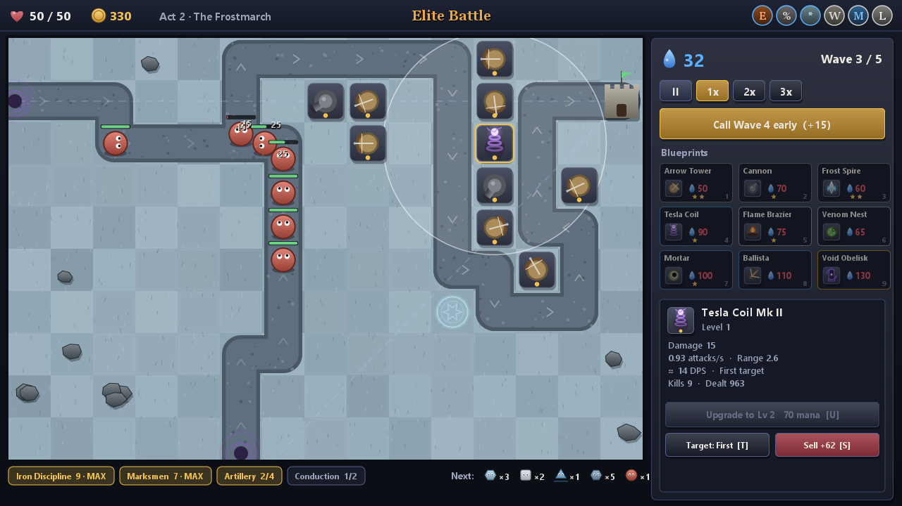
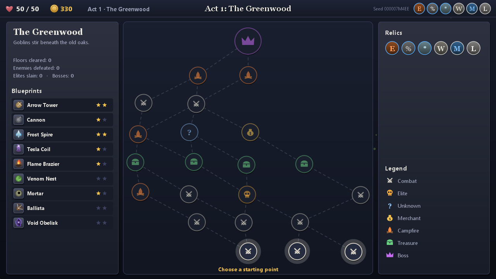
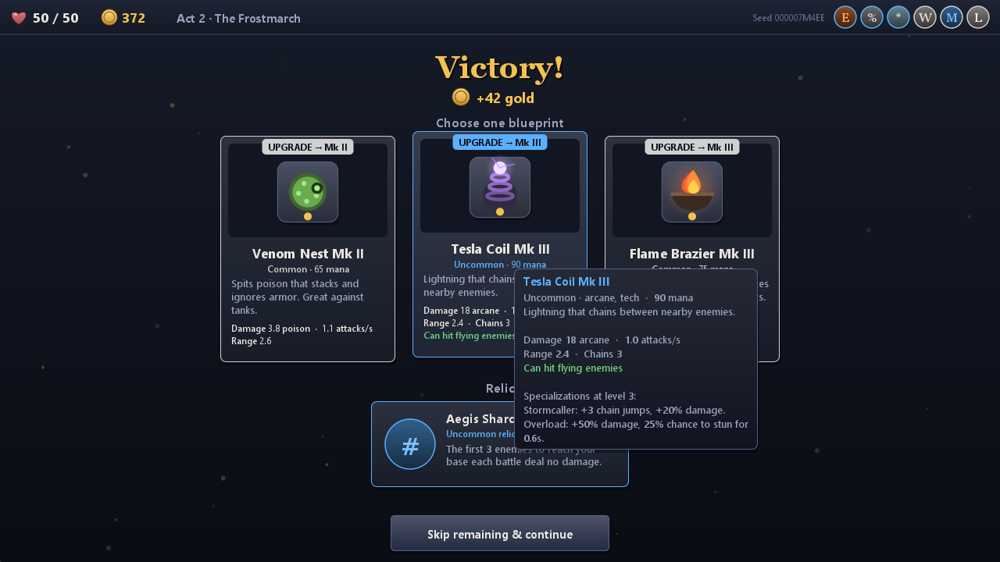
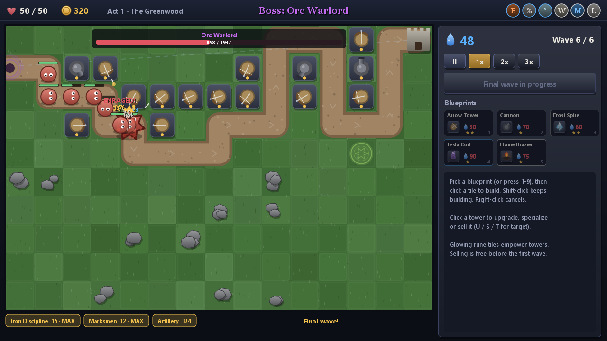
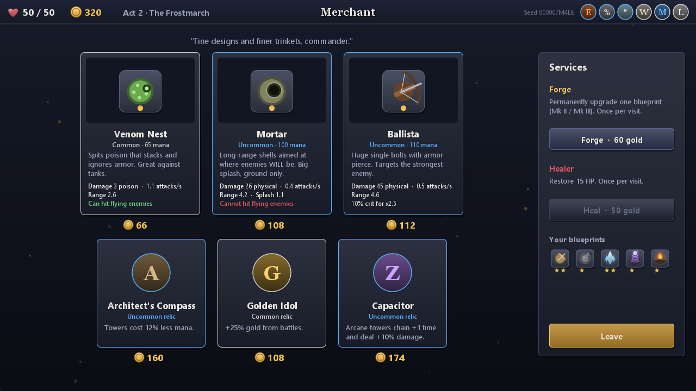
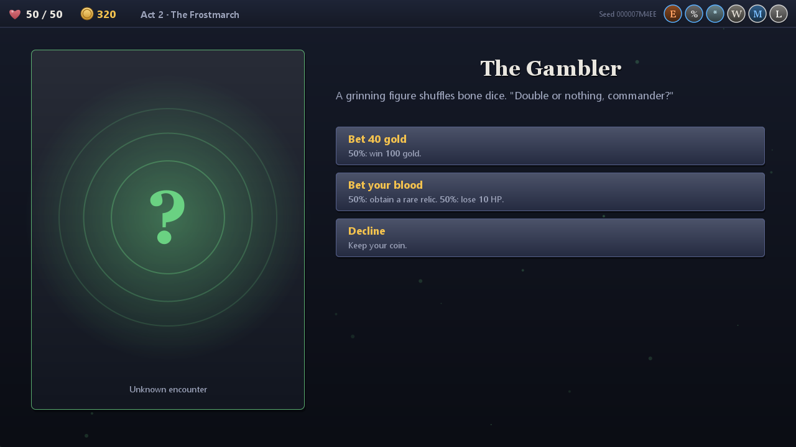
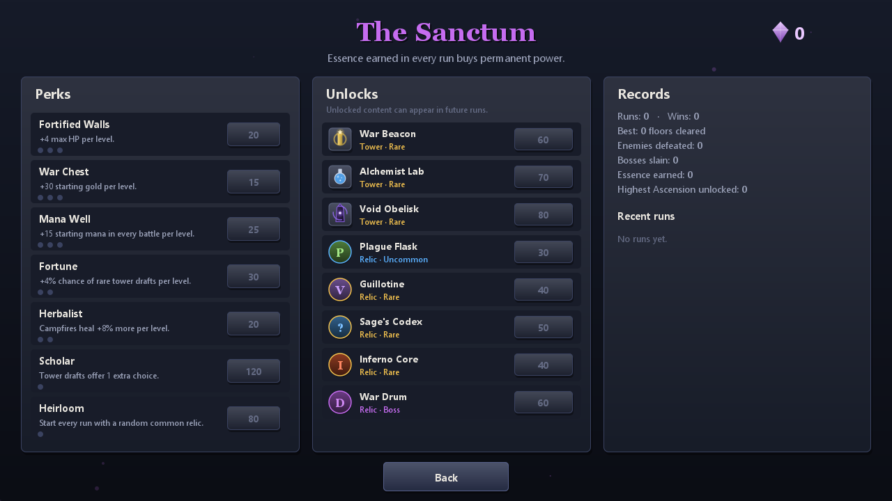
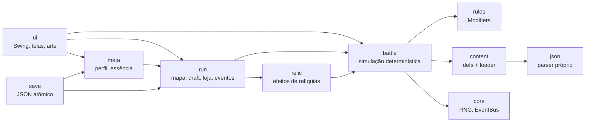

# Tower Rogue — Roguelike Tower Defense em Java

   



**[Português](#português)** · **[English](#english)**

---

## Português

Tower Rogue mistura **tower defense** com **roguelike**: você atravessa três atos num mapa ramificado, monta um arsenal de *blueprints* de torres batalha após batalha, coleta relíquias que mudam as regras do jogo e enfrenta chefes com fases. Cada run é diferente, mas toda run pode ser **reproduzida exatamente** a partir da sua seed.

O projeto começou como um tower defense acadêmico em Swing (v1, ~2 mil linhas, ainda no histórico do git) e foi **reescrito do zero** com foco em arquitetura de jogos: uma engine própria em Java puro, sem nenhuma biblioteca externa.

### Destaques

**Jogo**
- **Mapa de run ramificado** (estilo *Slay the Spire*): 3 atos × 7 andares + chefe, com nós de combate, elite, evento, loja, fogueira e tesouro.
- **Draft de torres**: após cada vitória, escolha 1 entre 3 cartas — um blueprint novo ou uma melhoria permanente (Mk II / Mk III). Raridades com proteção contra azar.
- **11 torres** com 3 níveis cada e **2 especializações exclusivas** no nível máximo; 5 tipos de ataque (projétil, corrente, pulso, suporte, gerador).
- **19 inimigos** (voadores, escudos, regeneração, invocadores, teleporte, renascimento) e **3 chefes com fases**; elites recebem **afixos** aleatórios.
- **32 relíquias** (estáticas e reativas, algumas com desvantagens), **8 sinergias** por tag e **reações elementais** (ex.: dano físico em inimigo congelado *estilhaça* com dano dobrado).
- **11 eventos** narrativos com escolhas e apostas.
- **Meta-progressão**: essência, 7 perks, desbloqueio de torres e relíquias, **10 níveis de Ascensão** e histórico de runs.

**Engenharia**
- **Simulação determinística** com timestep fixo de 60 Hz: mesma seed + mesmos comandos = partida idêntica, verificado por hash de estado.
- **Command pattern + replay**: toda ação do jogador vira um `BattleCommand` registrado com o tick em que foi executado.
- **Conteúdo 100% data-driven**: torres, inimigos, relíquias, eventos, atos, sinergias e balanceamento em JSON, validados na inicialização.
- **Parser JSON próprio** (recursive descent) — o jogo não tem nenhuma dependência.
- **Save/load** com escrita atômica, versionamento e quarentena de arquivos corrompidos; o estado de todos os geradores aleatórios é salvo.
- **Engine Swing própria**: loop dedicado com *active rendering* (`BufferStrategy`), resolução virtual 1280×720 com letterbox, UI *immediate mode*, partículas e **arte 100% procedural** (nenhuma imagem no projeto).
- **Ferramentas headless**: verificação de determinismo e **relatório de balanceamento** em que um bot joga centenas de batalhas em segundos.

### Screenshots

| Mapa da run | Recompensas (draft) |
|---|---|
|  |  |
| **Chefe com fases** | **Loja** |
|  |  |
| **Evento** | **Santuário (meta-progressão)** |
|  |  |

### Como executar

Pré-requisito: **JDK 21 ou mais recente** (não há outras dependências).

```bash
# Windows (PowerShell)
.\build.ps1

# Linux / macOS
./build.sh
```

Os scripts compilam com `javac` e, se a ferramenta `jar` estiver no PATH, geram `build/TowerRogue.jar`:

```bash
java -jar build/TowerRogue.jar
```

Sem o `jar`, rode direto das classes compiladas:

```bash
java -cp build/classes io.github.lucasstml.towerrogue.Main
```

O progresso fica em `~/.towerrogue/` (`profile.json` e `run.json`). Para usar outra pasta: `-Dtowerrogue.home=caminho`.

### Como jogar

1. Comece uma run (escolha a Ascensão e, se quiser, uma seed — qualquer texto vira uma seed).
2. No mapa, escolha o próximo nó. Batalhas dão ouro e um **draft**; elites e tesouros dão **relíquias**.
3. Em batalha, gaste **mana** para construir torres dos seus blueprints, melhorá-las e especializá-las. Abates e ondas concluídas dão mana; chamar a próxima onda mais cedo dá bônus.
4. Inimigos que chegam à base tiram **HP da run**. Chegou a 0, a run acaba — e a essência ganha compra melhorias permanentes no **Santuário**.

| Tecla | Ação |
|---|---|
| `1`–`9` | escolher blueprint |
| Clique / `Shift`+clique | construir / construir várias |
| Botão direito | cancelar |
| `Espaço` | iniciar onda / chamar a próxima antes |
| `P` · `F` | pausar · velocidade 1x/2x/3x |
| `U` · `S` · `T` | melhorar · vender · mudar alvo da torre selecionada |
| `D` · `H` · `F11` · `Esc` | números de dano · ajuda · tela cheia · menu |

### Ferramentas headless

```bash
java -cp build/classes io.github.lucasstml.towerrogue.Main --verify-determinism
```
Joga batalhas de todos os atos com um bot, reproduz o log de comandos numa batalha nova e compara os hashes de estado:
```
  act 1 BOSS    ticks=9360   commands=19  kills=135  WON   hash 6089183ff4b0844e vs 6089183ff4b0844e  OK
  act 3 BOSS    ticks=15057  commands=56  kills=221  WON   hash 55d8d12e2dff955b vs 55d8d12e2dff955b  OK
RESULT: deterministic
```

```bash
java -cp build/classes io.github.lucasstml.towerrogue.Main --balance-report 30
```
O bot joga 30 batalhas por linha (270 no total, em cerca de 2,5 segundos). Foi assim que os números dos JSON foram calibrados:

| Ato | Normal | Elite | Chefe |
|---|---|---|---|
| 1 | 100% | 100% | 100% |
| 2 | 97% | 100% | 83% |
| 3 | 97% | 100% | 70% |

### Arquitetura em um minuto



A regra central é que **a simulação (`battle`) não conhece a interface**. Ela só recebe comandos, avança em passos fixos e emite eventos visuais (`Fx`), que a UI transforma em partículas. É isso que permite rodar milhares de batalhas sem janela, provar o determinismo e trocar a apresentação sem tocar nas regras.

A explicação completa de cada sistema, das escolhas de design e dos trade-offs está em **[DOCUMENTACAO.md](DOCUMENTACAO.md)**.

### Estrutura

```
src/main/java/io/github/lucasstml/towerrogue/
├── Main.java              ponto de entrada (jogo + ferramentas headless)
├── core/                  Rng (SplitMix64), SeedCodec, EventBus, MathUtil
├── json/                  parser/writer JSON próprio
├── content/               definições imutáveis (records) + carregamento e validação
├── rules/                 Modifiers: regras agregadas de relíquias, perks e Ascensão
├── battle/                simulação: mapa, lanes, ondas, torres, inimigos, dano, comandos
│   └── ability/           habilidades de inimigos por composição
├── relic/                 efeitos de relíquias (estáticos e reativos)
├── run/                   estado da run, mapa ramificado, recompensas, loja, eventos
├── meta/                  perfil persistente e meta-progressão
├── save/                  persistência JSON
├── tools/                 bot (AutoPlayer) e ferramentas headless
└── ui/                    loop, input, UI immediate mode, arte procedural, partículas
    └── screens/           telas (menu, mapa, batalha, recompensas, loja, ...)
src/main/resources/data/   todo o conteúdo do jogo em JSON
docs/screenshots/          imagens deste README
```

### Adicionando conteúdo sem escrever Java

Uma torre nova é só uma entrada em `towers.json`:

```json
{
  "id": "storm_spire", "name": "Storm Spire", "rarity": "rare", "cost": 140,
  "description": "Chains lightning and slows.",
  "tags": ["arcane", "frost"], "kind": "chain", "damageType": "arcane",
  "stats": { "damage": 10, "cooldown": 1.0, "range": 2.6, "chain": 4, "hit_air": 1 },
  "onHit": [ { "status": "slow", "magnitude": 0.25, "duration": 1.5 } ],
  "upgrades": [ { "cost": 90, "mods": [ { "stat": "chain", "add": 1 } ] } ]
}
```

Ela já entra no draft, na loja, nas sinergias de `arcane` e `frost` e nas relíquias que afetam essas tags. Erros de digitação (stat inexistente, inimigo referenciado que não existe...) são apontados na inicialização com arquivo e id.

### Roadmap

- Testes automatizados (JUnit) e CI — a simulação já é testável sem janela.
- Áudio procedural (`javax.sound.sampled`).
- Replay de batalhas a partir de arquivo e modo "seed do dia".
- Mais atos, chefes e eventos (só JSON).

---

## English

Tower Rogue is a **roguelike tower defense** written in plain Java with **zero dependencies**. Cross three acts on a branching map, draft tower blueprints after every fight, collect relics that bend the rules and defeat multi-phase bosses. Every run is different, yet every run can be **replayed exactly** from its seed.

It started as a small academic Swing tower defense (v1, still in git history) and was **rewritten from scratch** with a focus on game architecture.

### Highlights

- **Branching run map** (Slay the Spire style): 3 acts × 7 floors + boss; combat, elite, event, shop, campfire and treasure nodes.
- **Tower drafting**: pick 1 of 3 cards after each win — a new blueprint or a permanent upgrade (Mk II / Mk III), with rarity pity.
- **11 towers**, 3 levels + **2 exclusive specializations** each; projectile, chain, pulse, support and generator attack kinds.
- **19 enemies**, elite **affixes**, **3 multi-phase bosses**; **32 relics**, **8 tag synergies**, elemental reactions (physical hits *shatter* frozen enemies).
- **Meta-progression**: essence, perks, unlocks, **10 Ascension levels**, run history.
- **Deterministic fixed-timestep simulation** (60 Hz), verified by state hashes; **Command pattern** with replayable logs.
- **Fully data-driven content** (JSON) parsed by a **hand-written JSON parser**, validated at startup.
- **Atomic, versioned saves** that include every RNG state.
- **Custom Swing engine**: dedicated loop with active rendering, virtual 1280×720 resolution, immediate-mode UI, particles and **100% procedural art**.
- **Headless tools**: determinism verification and a **bot-driven balance report** (270 battles in about 2.5 seconds).

### Run it

Requires **JDK 21+**.

```bash
./build.sh          # or .\build.ps1 on Windows
java -jar build/TowerRogue.jar                                   # if `jar` was available
java -cp build/classes io.github.lucasstml.towerrogue.Main       # otherwise
java -cp build/classes io.github.lucasstml.towerrogue.Main --verify-determinism
java -cp build/classes io.github.lucasstml.towerrogue.Main --balance-report 30
```

Controls: `1-9` blueprint · click build (`Shift` keeps building) · right-click cancel · `Space` start/call wave · `P` pause · `F` speed · `U`/`S`/`T` upgrade/sell/target · `H` help · `F11` fullscreen · `Esc` menu.

### Architecture

The simulation package (`battle`) knows nothing about the UI: it consumes commands, advances in fixed steps and emits cosmetic `Fx` events that the renderer turns into particles. That separation is what makes headless bot balancing, replay verification and UI changes possible without touching game rules. Relics plug in through an event bus and an aggregated `Modifiers` object instead of `if` statements in the core loop; enemies are composed from data-driven abilities rather than subclasses.

The full technical write-up (Portuguese) is in **[DOCUMENTACAO.md](DOCUMENTACAO.md)**.
